# 자료 검색, 근거 검증 기반 AI 분석 보고서

논문과 웹에서 근거를 모으고, 보고서의 모든 문장을 근거 원장에 묶은 뒤 **코드로 검증해서** 내보내는 Multi-Agent + Agentic RAG 파이프라인입니다.
<br>
<br>
첫 적용 주제는 KV cache 최적화 기술입니다. 같은 병목을 정반대 방식으로 푸는 두 기술(소프트웨어 DeepSeek-V2 MLA, 하드웨어 ITME)을 시장성 관점과 도메인 적용 관점에서 나란히 평가합니다. 목적은 우열 판정이 아니라 "관점에 따라 같은 기술이 어떻게 다르게 읽히는가"를 드러내는 것입니다.
<br>
<br>
LLM에게 "근거를 달아라", "중립적으로 써라"라고 말하는 것으로는 부족했습니다. 레드팀을 5회 돌리며 찾은 실패를 하나씩 코드 검사로 바꾼 과정과 그 트레이드오프는 [트러블슈팅](#troubleshooting), [트레이드오프](#tradeoffs)에 정리했습니다.

| 보고서 SUMMARY | 4.1 시장성 관점 표 | 도메인 전환 표 | 제출 전 점검 12항목 |
|:-:|:-:|:-:|:-:|
| 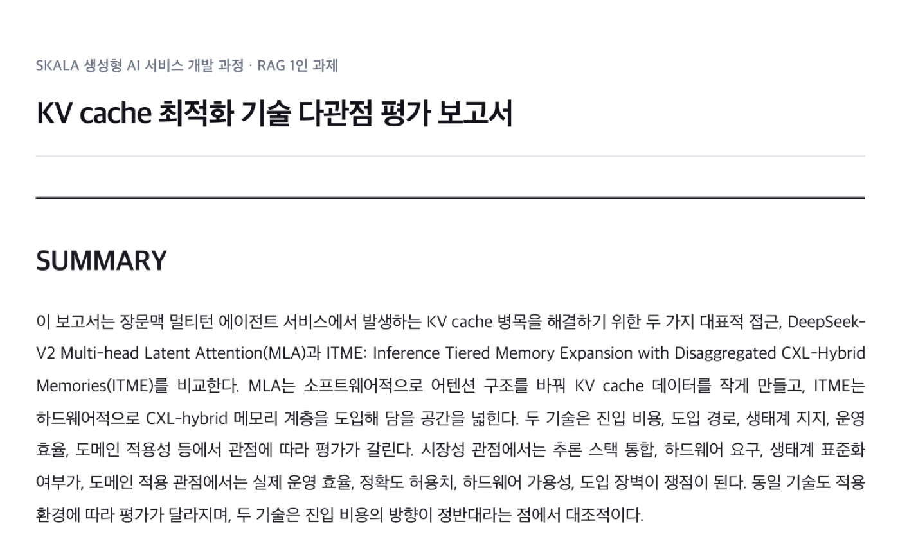 | 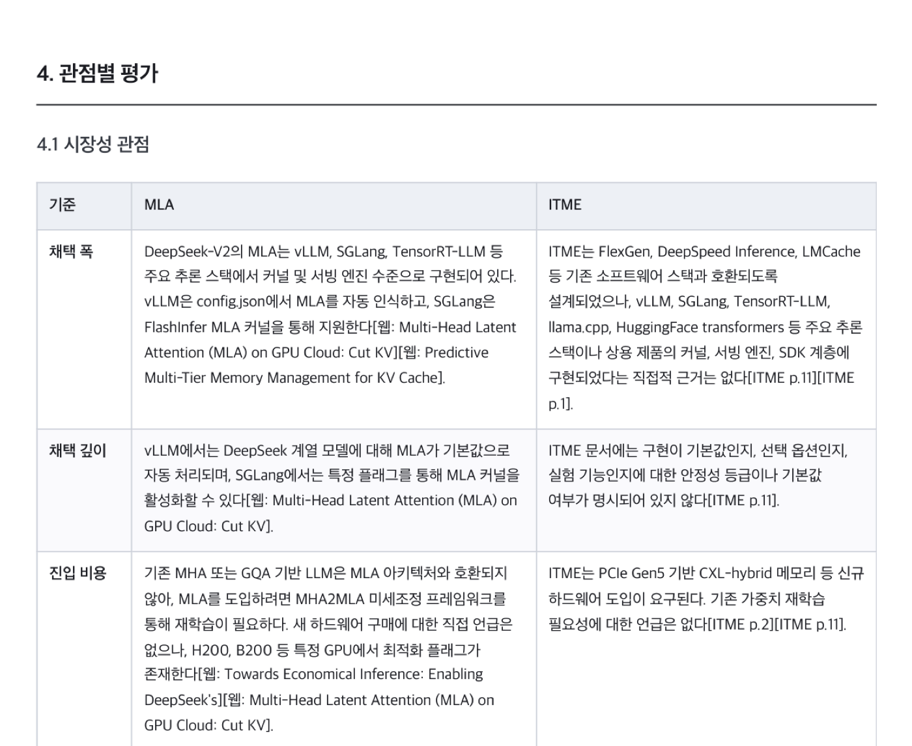 | 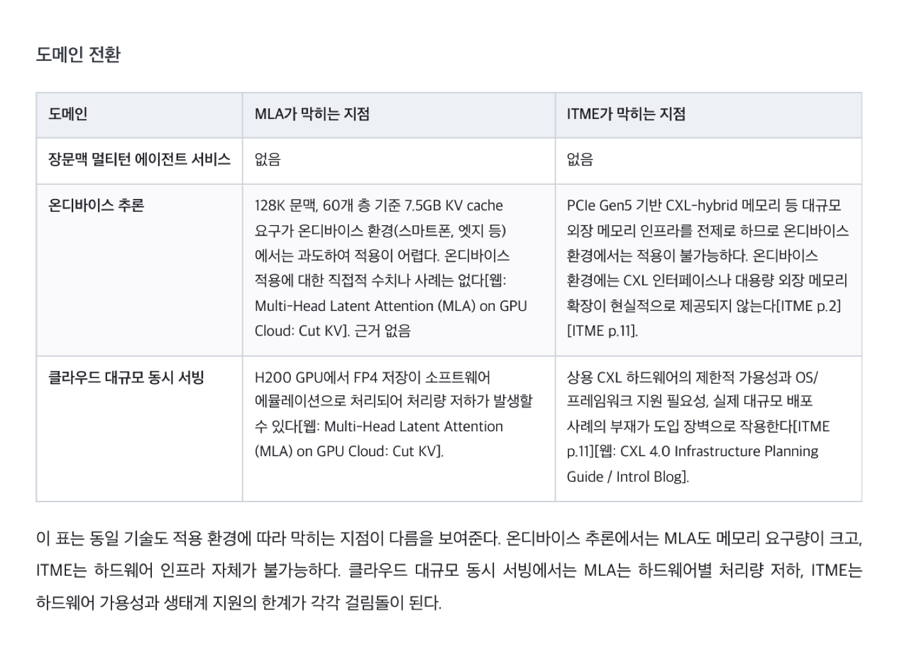 | 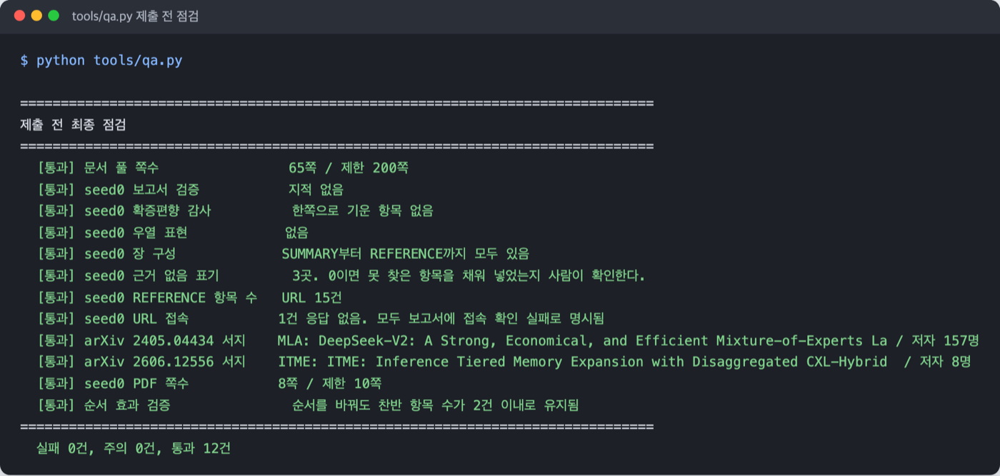 |
| 생성된 8쪽 보고서의 첫 쪽 | 모든 칸이 논문 쪽수나 웹 출처 꼬리표를 답니다 | 도메인을 바꾸면 막히는 지점이 달라집니다 | 실패 0, 주의 0, 통과 12 |

> 화면 출처: 보고서 화면은 2026-09-28 실행 결과(`outputs/report_seed0.md`)를 `tools/md2pdf.py`로 PDF 변환한 페이지입니다. 터미널 화면은 2026-11-05에 저장소를 새로 받아 API 키 없이 실제로 다시 돌린 `tools/qa.py`, `pytest`, `app.py compare`, `tools/rubric.py` 출력입니다.

<br>

## 📚 목차
- [🔭 Overview](#overview)
- [💻 Usage (실행 방법)](#usage)
- [📚 Tech Stack (구현 스펙)](#tech-stack)
- [🎯 Subject (문제 정의)](#subject)
- [🧪 Selected Technologies (평가 대상)](#selected-technologies)
- [🏗️ Architecture (구조)](#architecture)
- [🤖 Agents](#agents)
- [📱 Features (주요 기능)](#features)
- [🛡️ Quality Gates (검증)](#quality-gates)
- [🧨 Troubleshooting](#troubleshooting)
- [⚖️ Tradeoffs (이유 있는 코드)](#tradeoffs)
- [📅 Schedule (일정 관리)](#schedule)
- [🗂️ Directory Structure](#directory-structure)
- [👥 Contributors (팀 구성과 내 역할)](#contributors)

## 📖 Wiki

| 페이지 | 내용 |
|---|---|
| [Home](docs/wiki/Home.md) | 개요와 페이지 목록 |
| [Architecture](docs/wiki/Architecture.md) | 그래프, State, 검색 서브그래프, 데이터 흐름, 실행 환경 |
| [Evaluation](docs/wiki/Evaluation.md) | 임베딩 실측, 로더 실측, 감사와 순서 효과 수치, 점검 결과 |
| [Tradeoffs](docs/wiki/Tradeoffs.md) | 결정 로그 15건 (상황, 선택지, 결정, 비용, 다시 볼 조건) |
| [Troubleshooting](docs/wiki/Troubleshooting.md) | 레드팀 1~5차와 검증기 결함 기록 |
| [Schedule](docs/wiki/Schedule.md) | 실제 타임라인, 이슈와 PR로 일을 나눈 방식 |

[⬆️  목차로](#-목차)

<br>
<br>

## Overview

| 항목 | 내용 |
|---|---|
| Objective | 하나의 병목(KV cache)을 상반된 방식으로 푸는 두 기술을 복수 관점에서 비교 평가 |
| Method | Multi-Agent (LangGraph `Send` fan-out) + Agentic RAG (관련성 판정, k 확장, 질의 재작성 루프) |
| 산출물 | 근거 꼬리표가 달린 8쪽 PDF 보고서, 실행 State JSON (근거 원장 240건 포함) |
| 결과 | 보고서 검증 지적 0건, 제출 전 점검 12/12, 요구사항 대조 40/40, 테스트 59개 통과 |
| Tools | LangGraph, 자체 하이브리드 검색기(bge-m3 + BM25, RRF), Tavily Web Search, PyMuPDF |

한 번 실행에서 일어나는 일은 이렇습니다.

```
논문 2편(65쪽) 색인 → 기술 조사 (두 기술 병렬)
  → 시장성 평가, 도메인 평가 (2기술 x 2관점 = 4갈래 병렬, 찬반 질의 대칭)
  → 감사 (찬반 개수, 근거량 불균형을 코드로 셈. 기울면 재수집)
  → 평가 종합 → 보고서 생성 → 코드 검증기 (지적 있으면 재작성)
  → 기계적 정정 → PDF 변환 → 12항목 점검
```

[⬆️  목차로](#-목차)

<br>
<br>

## Usage

```bash
uv sync --python 3.11
cp .env.example .env          # OPENAI_API_KEY, TAVILY_API_KEY 입력

python data/fetch_papers.py        # 문서 풀 논문 2편 (평가 실행에 필요한 최소)
python data/fetch_papers.py --all  # 로더 비교 실측용 Doc Pool 후보 6편 전부

python app.py final           # 색인부터 제출 PDF까지 한 번에 (약 4분, 회당 0.2달러 안팎)

# 또는 단계별로
python app.py index           # 문서 풀 색인. 한 번만
python app.py run             # 평가 실행, 보고서 생성
python app.py run --seed 1    # 기술 제시 순서를 뒤집어 재실행
python app.py compare         # 두 실행의 결론이 갈리는지 비교

python eval/loader_probe.py   # PDF 로더 비교 실측 재현
python eval/embed_bench.py    # 임베딩 후보 비교 실측 재현
python tools/md2pdf.py outputs/report_seed0.md   # PDF 변환과 쪽수 검사
python tools/repair.py outputs/report_seed0.md   # 검증기 지적 자동 정정
python tools/qa.py            # 제출 전 최종 점검
python tools/rubric.py        # 요구사항 대조표
pytest tests/                 # 검증기와 그래프 구조 테스트 (API 키 불필요)
```

**API 키 없이 돌릴 수 있는 것**: `pytest`, `tools/qa.py`, `tools/rubric.py`, `tools/md2pdf.py`, `app.py compare`, `eval/loader_probe.py`. 저장소에 실행 결과(`outputs/state_seed*.json`, `report_seed*.md`)가 들어 있어서, 논문만 받으면 검증 단계 전체를 키 없이 재현할 수 있습니다.

[⬆️  목차로](#-목차)

<br>
<br>

## Tech Stack

| 항목 | 내용 |
|---|---|
| Language | Python 3.11 (uv) |
| Framework | LangGraph 1.x (`StateGraph`, `Send` fan-out, 조건부 엣지, 서브그래프) |
| LLM/Generator | gpt-4.1-mini (질의 번역, 관련성 판정, 근거 추출) |
| LLM/Judge | gpt-4.1 (평가 종합, 보고서 생성). 수치 검증에는 LLM을 쓰지 않음 |
| Retrieval | 자체 하이브리드 검색기 (조밀 코사인 + BM25, RRF 융합). 영어 질의 기준 Hit Rate@5 0.95, MRR 0.930 |
| Embedding | **BAAI/bge-m3** (오픈소스, 568M). 후보 4종 실측으로 선정 |
| Web Search | Tavily + 로컬 캐시 (`index/web_cache.json`, TTL 14일) |
| PDF | PyMuPDF (2단 조판 감지 로더), Chrome headless (보고서 PDF) |
| 테스트 | pytest 59개 (검증기 회귀, 그래프 구조, 설계 규약). 전부 네트워크와 API 키 없이 동작 |
| CI | GitHub Actions (pytest, 구문 검사, 문서 풀 200쪽 제한, 비밀키 유출 검사) |

### 임베딩 모델 선정 근거

리더보드 순위로 고르지 않았습니다. 이 문서 풀의 검색 조건이 일반 벤치마크와 다르기 때문입니다. 문서는 영문 논문이고 질의는 한국어이며, 찾아야 하는 것은 문장의 주제가 아니라 표 안의 수치와 약어입니다.
질의 20개와 사람이 고른 정답 문자열로 직접 측정했습니다 (`eval/embed_bench.py`, 결과 `outputs/embed_bench.json`).

| 모델 | 파라미터 | 색인(초) | 한국어 질의 Hit@5 | 한국어 하이브리드 Hit@5 | 영어 질의 Hit@5 | 영어 하이브리드 Hit@5 | 영어 하이브리드 MRR |
|---|---|---|---|---|---|---|---|
| **BAAI/bge-m3** | 568M | 24.6 | 0.85 | 0.55 | 0.95 | **0.95** | **0.930** |
| nlpai-lab/KURE-v1 | 568M | 24.3 | 0.80 | 0.55 | 0.95 | 0.95 | 0.897 |
| intfloat/multilingual-e5-large | 560M | 24.2 | 0.75 | 0.50 | 0.95 | 0.95 | 0.880 |
| paraphrase-multilingual-MiniLM-L12-v2 | 118M | 6.9 | 0.65 | 0.50 | 0.75 | 0.85 | 0.807 |

측정이 설계를 바꾼 지점이 셋 있습니다.

1. **질의를 영어로 옮기면 상위 세 모델이 Hit@5 0.95로 수렴합니다.** 모델을 바꾸는 것보다 질의 언어를 문서 언어에 맞추는 쪽이 효과가 컸습니다. 그래서 검색 서브그래프 앞단에 질의 현지화 노드(`localize`)를 넣었습니다.
2. **한국어 질의에서는 하이브리드가 오히려 점수를 깎습니다** (bge-m3 기준 0.85에서 0.55). BM25가 한국어 어절로 영문 문서를 찾으면 잡음만 더해집니다. 영어 질의에서는 반대로 MRR을 0.867에서 0.930으로 올립니다. 하이브리드를 무조건 쓰지 않고 현지화 뒤에 쓰는 이유입니다.
3. **한국어 특화 모델 KURE-v1이 한국어 질의에서 bge-m3보다 낮았습니다** (0.80 대 0.85). 계보만 보고 골랐다면 틀렸을 선택입니다.

Hit@5는 상위 세 모델이 같지만, 파이프라인은 상위 근거 몇 개만 LLM에 넣어 평가문을 쓰므로 순위 품질(MRR)이 곧 평가 품질이 됩니다. 경량 모델은 색인이 3.5배 빠르지만 색인을 한 번만 하므로 그 이점이 크지 않다고 봤습니다.

[⬆️  목차로](#-목차)

<br>
<br>

## Subject

### 🎯 문제 정의

이 프로젝트는 KV cache 최적화 기술을 소프트웨어와 하드웨어 두 진영에서 하나씩 골라, 시장성 관점과 도메인 적용 관점에서 평가하는 Multi-Agent + Agentic RAG입니다.
만들면서 어려웠던 것은 "보고서를 쓰는 것"이 아니라 **"LLM이 쓴 보고서를 믿을 수 있게 만드는 것"** 이었습니다. 문제를 셋으로 나눴습니다.

| 어려움 | 실제로 본 현상 | 나눈 방식 |
|---|---|---|
| 근거를 지어낸다 | 없는 arXiv 번호(`2406.00000`), 웹 수치에 논문 쪽수 꼬리표를 붙임 | 모든 문장을 **근거 원장 id**에 묶고, 꼬리표가 가리키는 원문에 그 수치와 단위가 실제로 있는지 코드로 대조 |
| 둘을 비교하면 한쪽으로 기운다 | "동등 또는 우수 보고" 같은 우열 서술 | 대칭 질의, 찬반 대칭 수집, 순서 뒤집어 두 번 실행, 감사 노드 등 **편향 방지 장치 7종**을 그래프 구조에 넣음 |
| 문서는 영어, 질의는 한국어 | 한국어 질의 + BM25 조합이 Hit@5를 0.85에서 0.55로 떨어뜨림 | 검색 직전에 질의를 영어로 옮기는 노드, 논문 사실에는 웹을 열지 않는 검색 경로 분리 |

> 범위: 네 관점 중 **시장성 관점**과 **도메인 적용 관점**만 다룹니다. 기술 성숙도(TRL)와 이해관계자 관점은 범위에서 뺐고, 해당 에이전트를 만들지 않았습니다(테스트로 고정). 기술 선정은 에이전트가 하지 않고 사람이 직접 했습니다.

### 확증편향 방지 전략

| 장치 | 방식 | 위치 |
|---|---|---|
| 대칭 질의 | 두 기술에 같은 질문 템플릿을 쓰고 기술 이름만 바꿈 | `agents/queries.py` |
| 찬반 대칭 수집 | 관점마다 유리한 근거와 불리한 근거를 별도 질의로 수집 | `agents/queries.py` |
| 순서 효과 제거 | 기술 제시 순서를 뒤집어 두 번 실행하고 결론 차이를 기록 | `graph.py prepare`, `app.py compare` |
| 근거 강제 | 근거 id 없는 문장은 검증에서 탈락 | `agents/nodes.py verify` |
| 수치 대조 | 보고서의 숫자가 근거 원문에 있는지 코드로 대조 | `agents/nodes.py verify` |
| 우열 표현 금지 | 금지어 어간 목록. 부정문("단정할 수 없다")은 통과 | `config.FORBIDDEN` |
| 감사 노드 | 찬반 근거 개수와 두 기술 간 근거량 불균형을 세어 기울면 재수집 | `agents/nodes.py audit` |

[⬆️  목차로](#-목차)

<br>
<br>

## Selected Technologies

| 진영 | 기술 | 무엇을 바꾸나 | 진입 비용 |
|---|---|---|---|
| SW | **DeepSeek-V2 MLA** (Multi-head Latent Attention, arXiv 2405.04434) | 어텐션 구조 자체를 바꿔 KV cache가 처음부터 작게 나오게 함 (압축률 93.3%) | 하드웨어는 그대로, 모델은 그 구조로 사전학습해야 함 |
| HW | **ITME** (Inference Tiered Memory Expansion with Disaggregated CXL-Hybrid Memories, arXiv 2606.12556) | CXL 메모리 계층을 추가해 담을 공간을 넓힘 | 모델은 그대로, 새 메모리 하드웨어를 들여야 함 |

선정 기준은 **진입 비용의 대칭성**입니다. 같은 병목을 두고 무엇을 바꿀 것인지가 정반대라서, 우열을 판정하지 않고도 관점에 따라 평가가 갈리는 모습을 보여 줄 수 있습니다.

- MLA: 사후 압축(TurboQuant, KIVI)은 이미 만들어진 KV cache를 줄이지만 MLA는 구조 자체를 바꿉니다. 진영 내 최대 압축률을 보고했고 상용 모델에 배포되어 시장 근거를 모을 수 있습니다.
- ITME: 같은 문서 풀의 InfiniGen은 기존 하드웨어 위에서 도는 소프트웨어 기법이라 진영 구분이 흐려집니다. ITME는 새 하드웨어 계층을 전제하므로 MLA와 정확히 대비되고, 멀티턴 워크로드를 직접 측정해 주 도메인(장문맥 멀티턴 에이전트 서비스)과도 맞습니다.

뺀 후보와 이유는 `config.py`의 `NOT_SELECTED`에 있고, 보고서 2장에 그대로 옮겨집니다. 선정 사유는 LLM이 생성하지 않고 사람이 쓴 문장을 주입합니다 ([트러블슈팅 5](#5-llm이-기술-선정-사유를-지어냈다-13)).

[⬆️  목차로](#-목차)

<br>
<br>

## Architecture

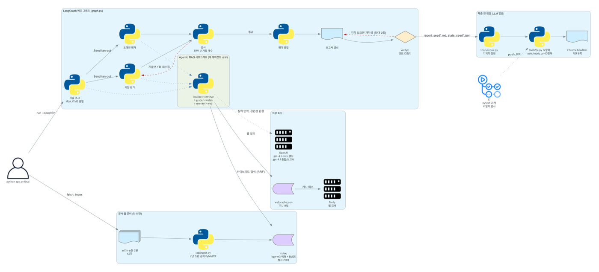

> 그림 생성 스크립트: [`docs/diagrams/architecture.py`](docs/diagrams/architecture.py). 클라우드 배포는 없고 전부 로컬에서 `python app.py`로 돕니다. 외부 호출은 OpenAI와 Tavily 두 곳입니다.

### 메인 그래프

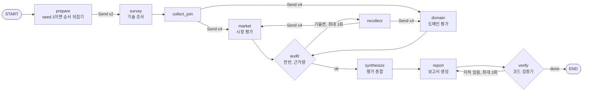

병렬 구간이 둘입니다. 기술 조사는 두 기술이 서로를 보지 않고 동작합니다. 한쪽 결과를 보고 다른 쪽을 조사하면 먼저 본 쪽이 기준이 되기 때문입니다. 관점 평가도 시장성과 도메인이 서로를 참조하지 않고, 겹치는 내용은 종합 단계에서 잇습니다.
되돌아가는 길도 둘입니다. 감사가 기울었다고 판정하면 모자란 쪽을 다시 모으고, 검증이 막히면 보고서를 다시 씁니다. 두 경로 모두 상한을 두어 무한 반복을 막습니다 (`tests/test_graph.py`가 고정).

### Agentic RAG 검색 서브그래프 (세 에이전트 공유)

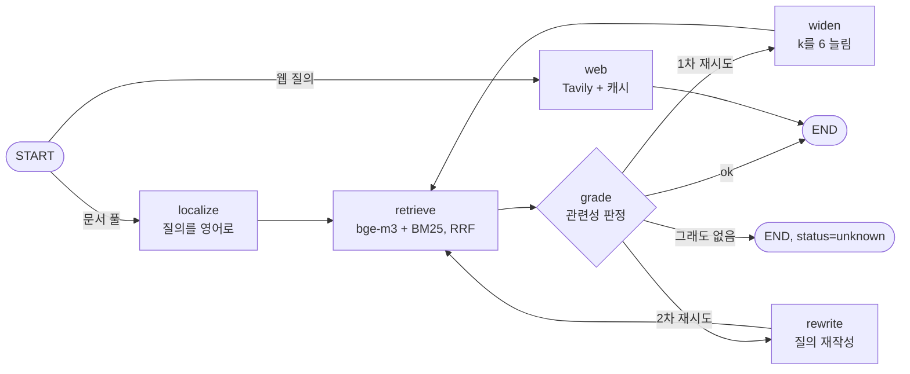

재시도 순서는 앞서 진행한 RAG 비교 실험(그래프 10종, 질문 84개)의 결과로 정했습니다.
같은 질의로 다시 검색하면 같은 문서가 돌아왔고, 질의는 두고 k만 넓혔을 때 정답이 27에서 30으로 늘었습니다. 그래서 k 확장이 먼저, 재작성이 나중입니다.
웹 폴백을 무조건 열었을 때는 웹 질문을 얻는 대신 문서 질문 오답이 1개에서 7개까지 늘었습니다. 그래서 질의 템플릿마다 문서 풀용 문장과 웹용 문장을 따로 두고, **문서 풀 질의에는 웹을 열지 않습니다** (`allow_web=False`). 웹은 시장 채택 현황처럼 논문에 있을 수 없는 항목의 웹 질의에만 쓰고, 기술 조사 템플릿에는 웹 문장이 아예 없습니다. 문서 풀에서 못 찾으면 `근거 없음`으로 남깁니다.
문서 풀 검색은 `where={"doc_id": 기술}`로 해당 기술의 논문으로만 범위를 좁혀, 한 기술의 근거가 다른 기술로 섞이지 않게 합니다.

### State: 병렬 갱신이 서로를 덮어쓰지 않게

| 키 | 리듀서 | 이유 |
|---|---|---|
| `tech_briefs`, `market`, `domain_fit` | `merge_by_key` (기술 id 하위 키 병합) | 4갈래 fan-out이 한 키에 같이 쓰면 마지막에 쓴 쪽이 이김 |
| `evidence` | `operator.add` (덧붙이기 전용) | 모든 평가 문장이 가리키는 **근거 원장**. 평가와 근거를 따로 들고 다니면 보고서 단계에서 짝이 어긋남 |
| `retries`, `retrieve_k` | `add_counts` | 재수집, 재시도 상한 계수 |

LangGraph가 그린 실제 그래프(`tools/draw_graph.py`로 생성):

| 메인 그래프 | 검색 서브그래프 |
|:-:|:-:|
| 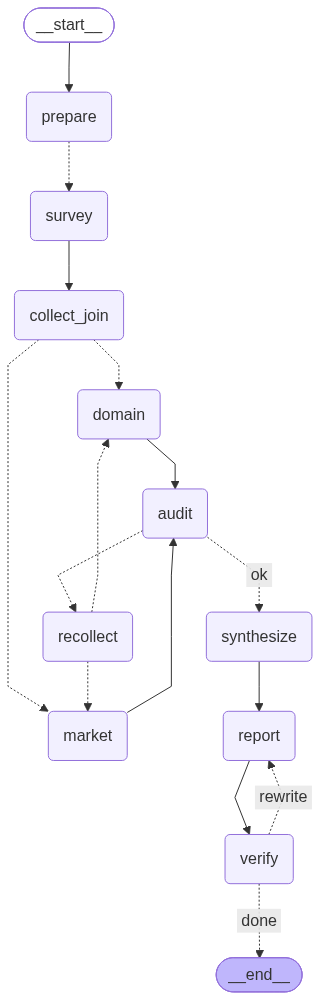 | 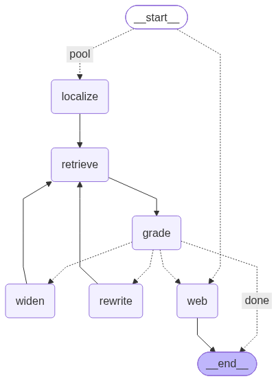 |

[⬆️  목차로](#-목차)

<br>
<br>

## Agents

| 에이전트 | 역할 | RAG | 근거 출처 |
|---|---|---|---|
| 기술 조사 | 논문 원문에서 접근 방식, 보고 수치, 성립 조건, 저자가 밝힌 한계를 추출 | O | 문서 풀만 |
| 시장 평가 | 채택 폭과 깊이, 진입 비용, 생태계 지지, 시장 수치를 조사 | O | 문서 풀 + 웹 |
| 도메인 평가 | 주 도메인 적합성과 대조 도메인(온디바이스, 클라우드 대규모 서빙) 전환 시 변화를 조사 | O | 문서 풀 + 웹 |
| 평가 종합 | 두 관점이 엇갈리는 지점과 도메인 전환 시 뒤집히는 지점을 추출 | X | 앞 단계 결과 |
| 보고서 생성 | 10쪽 제한 보고서 작성. 참고문헌은 LLM이 쓰지 않고 근거 원장에서 기계적으로 생성 | X | 앞 단계 결과 |

에이전트를 나눈 기준은 **무엇을 근거로 삼는가**입니다. 근거의 출처가 같은 일을 한 에이전트에 묶어 두면 검증할 지점이 한 곳으로 모입니다.
평가 기준은 점수가 아니라 관찰 항목입니다 (`config.MARKET_CRITERIA` 5개, `config.DOMAIN_CRITERIA` 5개). 근거가 없으면 빈칸이 아니라 `근거 없음`으로 남깁니다. 빈칸은 "없는 것"인지 "못 찾은 것"인지 구별되지 않기 때문입니다.

[⬆️  목차로](#-목차)

<br>
<br>

## Features

| 근거 꼬리표가 달린 관점별 평가 | 도메인 적용 관점 표 | 관점 간 상충과 도메인 전환 |
|:-:|:-:|:-:|
|  | 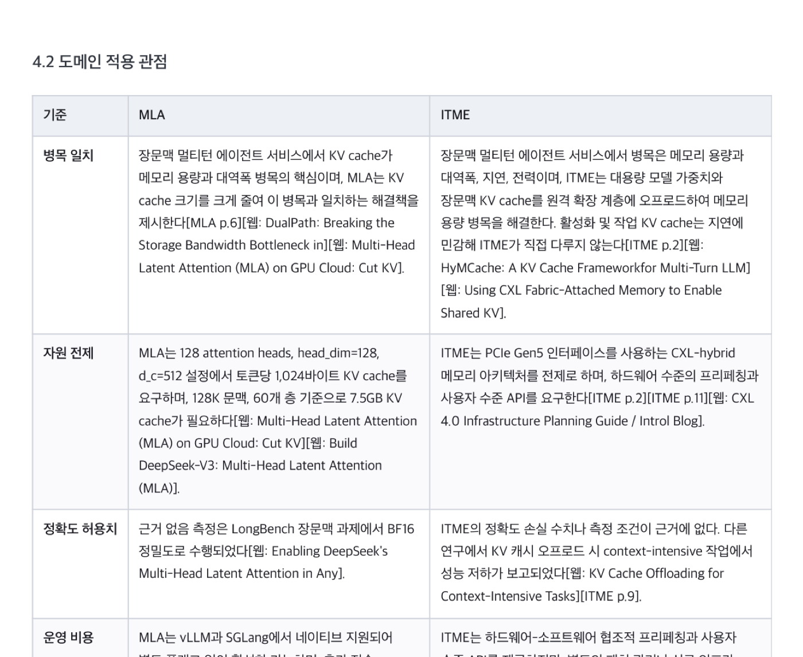 | 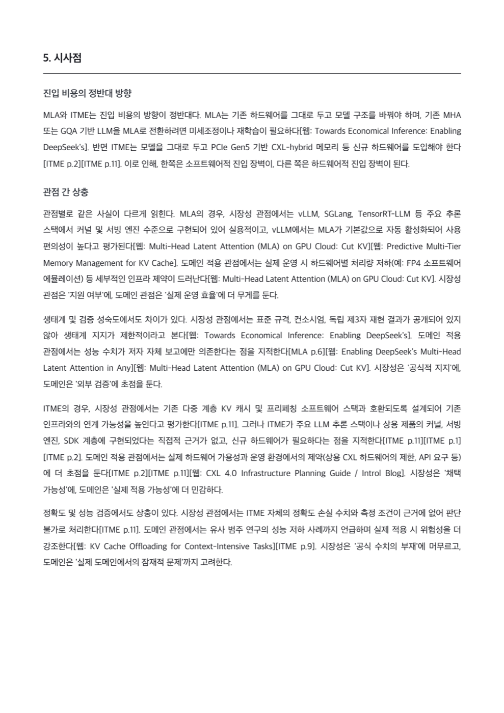 |
| 표의 모든 칸이 `[MLA p.1]`, `[웹: 제목]` 꼬리표를 답니다 | 근거가 없는 칸은 `근거 없음`으로 남깁니다 | 같은 사실이 시장성과 도메인에서 다르게 읽히는 지점을 짚습니다 |

| 기계 생성 참고문헌 | 순서 효과 비교 | 검증기 회귀 테스트 |
|:-:|:-:|:-:|
| 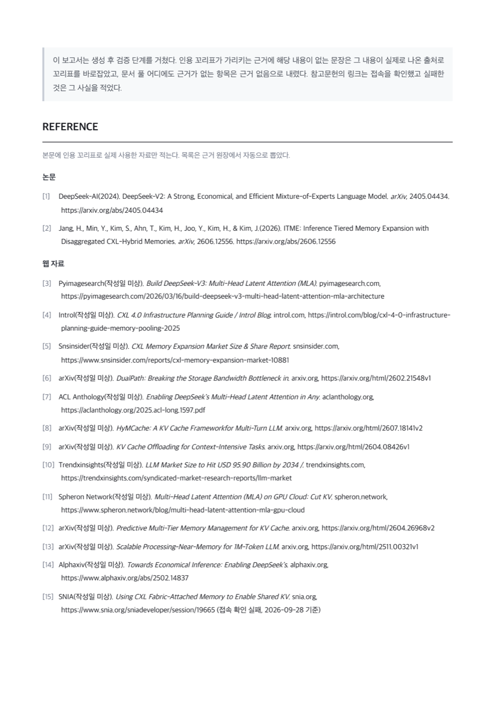 | 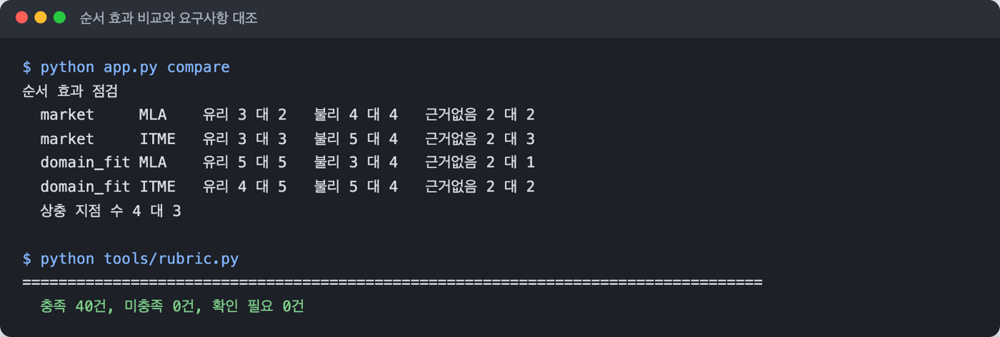 | 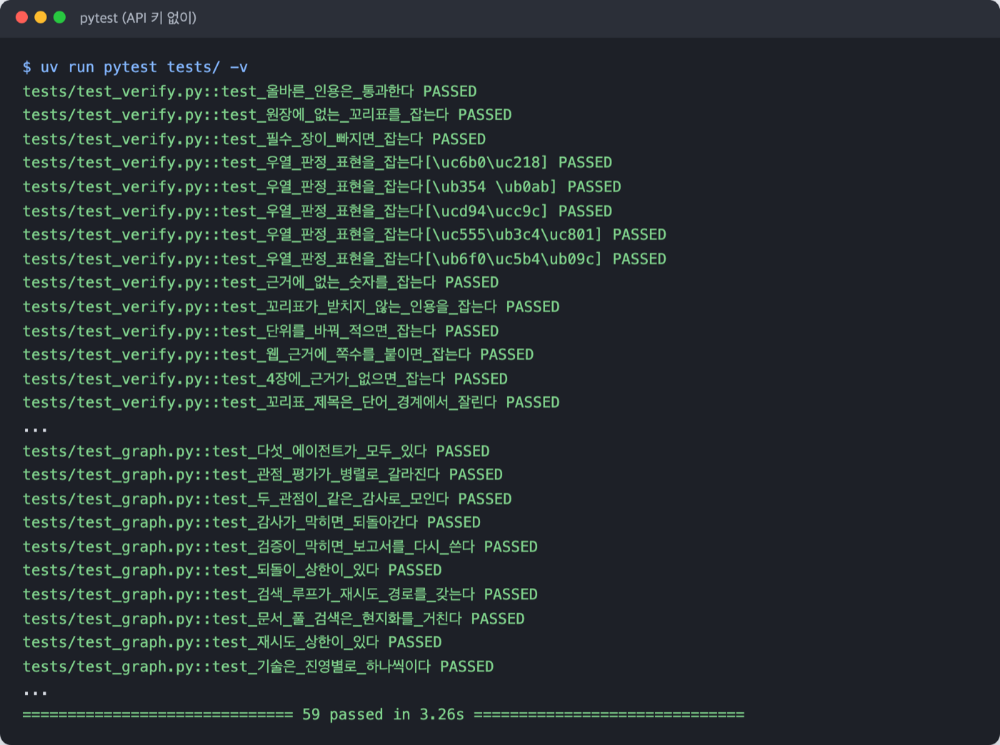 |
| 본문에 실제로 박힌 꼬리표만 모아 서지를 붙이고, 죽은 링크는 명시 | 기술 순서를 뒤집어도 찬반 항목 수 차이 2건 이내 | 레드팀 사례를 테스트로 고정, 59개 통과 |

- **2단 조판 인식 PDF 로더**: 쪽마다 2단 여부를 감지해 왼쪽 열을 다 읽고 오른쪽 열로 넘어갑니다. 단어 붙음 비율 0.033에서 0.016, 핵심 수치 70종 중 69종 보존 ([#1](https://github.com/YooGyeongMo/kv-cache-eval-agentic-rag/issues/1)).
- **질의 현지화**: 문서 풀 검색 직전에 질의를 영어로 옮깁니다. 웹 질의는 처음부터 영어로 적습니다.
- **웹 근거 출처 등급**: 웹 근거를 일차(논문, 코드, 벤더 문서), 시장조사, 이차로 나눠 붙입니다. 실행 결과 MLA 일차 7건, 이차 49건 / ITME 일차 14건, 이차 42건.
- **근거 원장 대칭**: seed 0 실행에서 근거 240건, 두 기술 각각 120건 (논문 64, 웹 56, 유리 24, 불리 40).
- **웹 검색 캐시**: 정방향이 던진 질의를 역방향이 그대로 씁니다. 정방향 새 검색 28회, 역방향 캐시 적중 28회. 한도를 절반만 쓰고 두 실행의 근거가 같아져 순서 효과 비교 조건이 맞습니다.

[⬆️  목차로](#-목차)

<br>
<br>

## Quality Gates

보고서를 LLM에 맡기고 끝내지 않습니다. 레드팀을 돌리며 발견한 실패 방식을 코드 검사로 바꿔 `agents/nodes.py verify`와 `tools/qa.py`에 모았습니다.
LLM 채점기를 쓰지 않은 이유는 앞선 실험에서 충실성 채점기가 틀린 숫자 23건 중 2건만, 근거 채점기는 21건 중 1건만 잡았기 때문입니다.

| 검사 | 실제로 잡은 사례 |
|---|---|
| 참고문헌 기계 생성 | LLM이 `arXiv:2406.00000` 같은 없는 번호와 무관한 문서를 참고문헌에 올림 |
| 꼬리표 존재 대조 | 근거 원장에 없는 인용 꼬리표를 지어냄 |
| **꼬리표 내용 대조** | 웹에서 본 `Llama2-7B 3% 손실`에 `[MLA p.6]`을 붙임. 그 쪽은 어텐션 구조 설명이라 해당 내용이 없음 |
| 수치 대조 | 근거 원문에 없는 숫자를 본문에 씀 |
| 단위 변환 금지 | `1.3 billion`을 `13억 달러`로 바꿔 적어 원 표기를 가림 |
| 우열 표현 금지 | `동등 또는 우수 보고`처럼 우열을 판정하는 서술 |
| 비교 기준선 대조 | ITME의 35.7%는 CPU 오프로딩 대비인데 재계산 대비로 적음 |
| URL 생존 확인 | 참고문헌 9건 중 3건이 404와 403이었음 |
| 정식 명칭 고정 | ITME를 `Inter-Tier Memory Expansion`으로 지어냄 |
| 기법과 모델 분리 | DeepSeek-V2 **모델**의 규모를 MLA **기법**의 요구 사항으로 적음 |
| 공개 연도 대조 | 두 기술의 공개 연도를 뒤바꿔 적음 (MLA 2026, ITME 2024) |
| **단위까지 대조** | `64배`에 `[MLA p.6]`을 달았는데 그 쪽엔 `64`가 차원 값으로만 있었음 |
| 선정 사유 고정 | 선정 사유를 프롬프트에 안 줘서 LLM이 임베딩 선정 이야기를 지어냄 |
| 쪽수 제한 | 문서 풀 200쪽(실제 65쪽), 보고서 10쪽(실제 8쪽) |
| **검색 빈손 감지** | 웹 검색 한도가 차서 전부 빈 응답인데 파이프라인이 정상 종료, 시장성 관점이 통째로 "정보 없음" |

검증기가 잡은 것 중 규칙이 분명한 것은 `tools/repair.py`가 LLM 없이 정정합니다. 수치가 실제로 있는 쪽으로 꼬리표 교정, 단위 복원, 연도 교정, 그리고 문서 풀 어디에도 근거가 없는 항목은 `근거 없음`으로 내립니다. 정정을 거쳤다는 사실은 보고서 끝에 명시합니다.

| 단계 | seed 0 (정방향) | seed 1 (역방향) |
|---|---|---|
| 생성 직후 검증 지적 | 2건 (원장에 없는 웹 꼬리표 1, 상투어 1) | 1건 (근거에 없는 숫자 `165`) |
| 정정 후 `tools/qa.py` | 실패 0, 주의 0, 통과 12 | 순서 효과 검증 통과 |

> 출처: 생성 직후 지적은 `outputs/state_seed*.json`의 `verify`, 정정 후 결과는 2026-11-05 재실행한 `tools/qa.py` 출력.

[⬆️  목차로](#-목차)

<br>
<br>

## Troubleshooting

### 1. 참고문헌이 통째로 날조됐다 [#5](https://github.com/YooGyeongMo/kv-cache-eval-agentic-rag/issues/5)

1차 실행의 REFERENCE가 전부 거짓이었습니다. DeepSeek-V2는 제목과 arXiv 번호(`2406.00000`, 없는 번호)가 틀렸고, ITME는 저자를 `Kim et al.`로 지어냈고, 과제와 무관한 IMS Global 문서가 올라가 있었습니다.
<br>
원인은 참고문헌을 LLM이 쓰게 둔 것이었습니다. 검색 중 스쳐 간 문서가 목록에 올라갔고 서지는 그럴듯하게 만들어졌습니다.
<br>
참고문헌 생성을 LLM에서 떼어냈습니다. 서지는 `data/pool.json`에 사람이 적고, 본문에 실제로 박힌 꼬리표만 모아 원장에서 꺼내 붙이며, 적어 둔 서지 자체는 `tools/qa.py`가 arXiv 원본과 대조합니다.

<details>
<summary>attach_reference 핵심 (agents/nodes.py)</summary>

```python
body = re.split(r"\n#{1,3}\s*REFERENCE\s*\n", md)[0].rstrip()  # LLM이 쓴 REFERENCE는 버린다
tags = {norm_cite(t) for t in CITE.findall(body)}              # 본문에 실제로 쓴 꼬리표만
for doc_id, meta in POOL_META.items():                         # 논문 서지는 pool.json에서
    if any(re.match(rf"^{re.escape(doc_id)}\s+p\.\d+$", t) for t in tags):
        papers.append(f"- {meta['authors']}({meta['year']}). {meta['title']}. ...")
alive = probe_urls(cited_urls)                                 # 웹 링크는 생존 확인 후 실패를 명시
```
</details>

<br>

---

### 2. 꼬리표는 실재하는데 내용이 받치지 않았다 [#7](https://github.com/YooGyeongMo/kv-cache-eval-agentic-rag/issues/7)

`| 정확도_허용치 | Llama2-7B 변환 시 3% 정확도 손실 보고[MLA p.6] |`
<br>
`MLA p.6`은 어텐션 구조 설명이고 Llama2-7B도 3%도 없습니다. 웹에서 본 다른 기법의 수치에 논문 꼬리표를 붙인 것입니다.
<br>
검증기가 **꼬리표가 원장에 존재하는지만** 봐서 통과했습니다. 쪽수까지 달린 인용은 겉보기에 가장 성실해 보여서 사람도 열어 보지 않으면 넘어갑니다.
<br>
문장(표 한 칸) 단위로 쪼개고, 그 안의 꼬리표가 가리키는 근거 원문에 수치와 고유 표기가 실제로 있는지 대조하도록 바꿨습니다. `test_꼬리표가_받치지_않는_인용을_잡는다`가 이 사례를 고정합니다.

<details>
<summary>꼬리표 내용 대조 (agents/nodes.py verify)</summary>

```python
for unit in re.split(r"(?<=[.。])\s+|\n|\|", body):
    pool_tags = [t for t in tags if re.match(r"^(MLA|ITME)\s+p\.\d+$", t)]
    backing = " ".join(by_cite.get(t, "") for t in pool_tags).lower()
    for tok in set(TOKEN.findall(CITE.sub("", unit))):
        if not backed_by(tok, backing):          # 숫자뿐 아니라 단위 문맥까지 본다
            mismatched.append(f"'{tok}' (꼬리표 {', '.join(pool_tags)})")
```
</details>

<br>

---

### 3. 숫자만 맞으면 통과했다: `64배` [#13](https://github.com/YooGyeongMo/kv-cache-eval-agentic-rag/pull/13)

`KV cache를 64배 이상 줄여 ... [MLA p.6]`. 그 쪽에는 `64`가 헤드 수(차원 값)로만 있고 배수 이야기는 없었습니다.
<br>
2번에서 만든 대조가 숫자 문자열만 봤기 때문입니다. `backed_by()`가 단위 문맥까지 보도록 고쳤고, 같은 칸에 웹 출처가 있으면 문장을 지우지 않고 잘못 붙은 논문 꼬리표만 뗍니다.
<br>
또 검증기와 정정기가 판정 함수를 따로 갖고 있어서 검증기가 잡는 `64배`를 정정기가 못 봤습니다. 같은 함수를 쓰게 통일했습니다.

<details>
<summary>단위 문맥 대조 테스트</summary>

```python
assert not backed_by("64배", "with 64 heads and a head dimension of 128")
assert     backed_by("5.76배", "boosts throughput to 5.76 times")
```
</details>

<br>

---

### 4. LLM 크레딧이 막혀 보고서를 다시 만들 수 없었다 [#9](https://github.com/YooGyeongMo/kv-cache-eval-agentic-rag/issues/9), [#11](https://github.com/YooGyeongMo/kv-cache-eval-agentic-rag/pull/11)

레드팀 3차 수정을 반영한 보고서를 다시 만들어야 했는데 OpenAI 프로젝트의 모델 접근이 403으로 막혔습니다 (키는 유효, 모델 허용 목록 0개).
<br>
검증기 지적 중 상당수는 규칙이 분명해서 LLM 없이 고칠 수 있다는 점에 주목했습니다. `tools/repair.py`를 만들어 **판단이 필요 없는 것만** 정정했습니다.

| 정정 전 지적 6건 | 처리 |
|---|---|
| `5.76배`가 `[MLA p.6]`으로 인용됨 | 같은 문서에서 그 수치가 실제로 있는 `p.1`로 출처 교정 |
| `35.7%` `[ITME p.11]` | `p.10`으로 교정 |
| `Llama2-7B 3% 손실` | 문서 풀 어디에도 없음, `근거 없음`으로 내림 |
| `MLA 2026년, ITME 2024년` | `pool.json` 서지로 연도 교정 |
| `13억 달러`, `118억 달러` | 원 표기 `1.3 billion`, `11.8 billion`으로 복원 |

결과: 정정 전 6건, 정정 후 0건. 이후 크레딧이 복구되어 최종본은 처음부터 다시 생성했고, 정정 단계는 파이프라인의 마지막 안전망으로 남겼습니다.

<br>

---

### 5. LLM이 기술 선정 사유를 지어냈다 [#13](https://github.com/YooGyeongMo/kv-cache-eval-agentic-rag/pull/13)

보고서 2장에 `선정은 사람이 직접 문서 풀에서 질의-정답 쌍을 기준으로 임베딩 후보를 평가하여 이루어졌다`가 나왔습니다. 기술 선정과 임베딩 선정을 뒤섞은 문장입니다.
<br>
원인은 `config.TECHS[*].why`와 `NOT_SELECTED`를 보고서 프롬프트에 넘기지 않은 것이었습니다. 재료가 없으니 지어냈습니다.
<br>
선정은 사람이 했으므로 **생성할 것이 아니라 옮겨 적을 것**입니다. `selection_note()`가 사람이 쓴 사유를 그대로 주입합니다.

<br>

---

### 6. 깨진 데이터로 고치면 원문보다 나빠졌다 [#14](https://github.com/YooGyeongMo/kv-cache-eval-agentic-rag/pull/14)

정정기가 `15.5`를 고치려다 `14.99`로 만들었습니다. 웹 스크래핑이 `USD16. 55 Billion`으로 소수점 뒤를 끊어 놓았고, 정정기가 `55`를 값으로 읽었습니다.
<br>
추측으로 교정하는 경로를 막고, 소수점 주위 공백을 허용해 원래 값을 되살리는 쪽으로 바꿨습니다. 같은 PR에서 `Gen5`와 `gen5` 대소문자 미일치로 멀쩡한 서술이 지워지던 것, `35.7퍼센트`를 수치로 인식하지 못하던 것도 고쳤습니다.

<br>

---

### 7. 웹 검색이 전부 빈손인데 정상 종료됐다 [#14](https://github.com/YooGyeongMo/kv-cache-eval-agentic-rag/pull/14)

재실행을 반복하다 Tavily 무료 한도를 다 썼습니다. 검색이 모두 빈 응답이었는데 감사를 통과해, 시장성 관점이 통째로 "정보 없음"인 보고서가 나왔습니다.
<br>
감사가 찬반 개수만 셌기 때문입니다. 시장성 관점에 웹 근거가 0건이면 감사 실패로 판정하도록 근거의 **종류**까지 세게 했고, 질의를 키로 결과를 저장하는 `rag/webcache.py`를 넣어 재실행 시 한도를 쓰지 않게 했습니다.

<details>
<summary>audit 추가 조건</summary>

```python
web_total = sum(1 for e in s.get("evidence", [])
                if e["source_type"] == "web" and e["perspective"] == "market")
if web_total == 0:
    report["flags"].append("시장성 관점에 웹 근거가 한 건도 없다. ...")
```
</details>

더 많은 사례(기법과 모델 혼동, 꼬리표 절단 불일치, `Gen5를` 정규식 오탐, 기준선 오탐)는 [Wiki Troubleshooting](docs/wiki/Troubleshooting.md)에 있습니다.

[⬆️  목차로](#-목차)

<br>
<br>

## Tradeoffs

### LLM 채점기 대신 코드 검증기

| | 내용 |
|---|---|
| 대안 | LLM-as-a-judge로 충실성, 근거성 채점 |
| 고른 이유 | 앞선 실험에서 LLM 채점기가 틀린 숫자 23건 중 2건, 21건 중 1건만 잡음. 숫자, 꼬리표, 금지어는 규칙이 분명해 코드가 정확함 |
| 비용 | 정규식 검사라 거짓 양성이 생김 (`Gen5를`, 대소문자, 기준선 오탐). 거짓 양성이 많은 검사는 결국 꺼지므로 매번 결함으로 다뤄 고치고 테스트로 고정해야 함 |
| 바꿀 조건 | 수치가 아닌 서술의 타당성(논리 비약 등)을 봐야 할 때는 LLM 채점을 보조로 추가 |

### 재시도 순서: k 확장 → 질의 재작성 → (허용될 때만) 웹

| | 내용 |
|---|---|
| 대안 | 실패하면 바로 질의 재작성, 또는 바로 웹 폴백 |
| 고른 이유 | 질의 그대로 k만 넓혔을 때 정답 27에서 30. 웹 폴백을 열면 문서 질문 오답이 1에서 7로 늘었음 |
| 비용 | 논문에 정말 없는 사실은 `근거 없음`으로 남아 보고서가 덜 채워짐 (seed 0에서 3곳) |
| 바꿀 조건 | 문서 풀이 커져 논문 밖 근거가 필수인 질의가 늘면 웹 허용 질의 목록을 넓힘 |

### FAISS 대신 numpy 행렬 + BM25 직접 구현

| | 내용 |
|---|---|
| 대안 | FAISS 인덱스 + LangChain `EnsembleRetriever` |
| 고른 이유 | 청크 211개라 전수 코사인으로 충분하고, RRF 순위와 `where` 필터(진영, 문서)를 한 함수에서 투명하게 다루고 싶었음. 앞선 실험에서 `EnsembleRetriever`의 weights가 점수 비율이 아니라 가중 RRF임을 확인해 직접 RRF로 씀 |
| 비용 | 문서가 수만 청크로 늘면 느려짐. 의존성 목록에는 faiss-cpu가 남아 있음 |
| 바꿀 조건 | 청크가 1만 개를 넘으면 FAISS로 교체 (검색기 인터페이스 `search(query, k, where)`는 유지) |

### 참고문헌과 선정 사유는 생성하지 않고 주입

| | 내용 |
|---|---|
| 대안 | LLM이 보고서 전체를 작성 |
| 고른 이유 | 두 곳 모두 LLM이 실제로 지어냄 (#5, #13). 사람이 정한 사실은 옮겨 적을 대상 |
| 비용 | `pool.json`과 `config.py`를 사람이 관리해야 함 |
| 바꿀 조건 | 평가 대상을 에이전트가 고르게 바꾸면 선정 사유도 생성 대상이 되고, 그때는 선정 근거를 원장에 묶어야 함 |

나머지 결정(임베딩 모델, State 리듀서, 웹 캐시 TTL, 순서 효과 2회 실행, 재수집 상한 등) 전체 15건은 [Wiki Tradeoffs](docs/wiki/Tradeoffs.md)에 표로 정리했습니다.

[⬆️  목차로](#-목차)

<br>
<br>

## Schedule

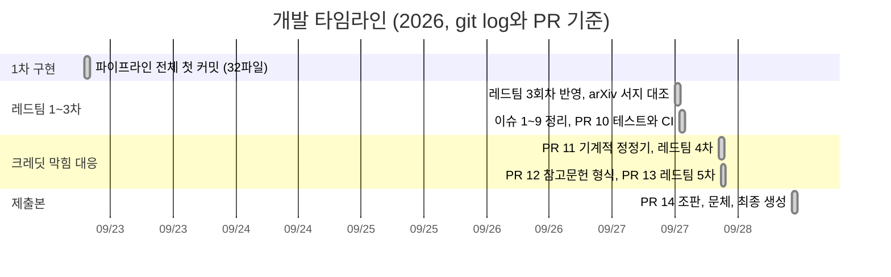

| 날짜 | 한 일 | 근거 |
|---|---|---|
| 09-22 | Multi-Agent 그래프, 검색 서브그래프, 하이브리드 검색기, 검증기, 실측 스크립트를 한 커밋으로 올림 (9,867줄) | `801b2b4` |
| 09-27 오전 | 레드팀 3차 반영 (꼬리표 내용 대조, 출처 등급, URL 생존), 작업 단위를 이슈 9건으로 정리, 테스트 39개와 CI | `9546501`, [#10](https://github.com/YooGyeongMo/kv-cache-eval-agentic-rag/pull/10) |
| 09-27 저녁 | OpenAI 403으로 재생성이 막힌 상태에서 LLM 없는 정정기와 레드팀 4, 5차 | [#11](https://github.com/YooGyeongMo/kv-cache-eval-agentic-rag/pull/11), [#12](https://github.com/YooGyeongMo/kv-cache-eval-agentic-rag/pull/12), [#13](https://github.com/YooGyeongMo/kv-cache-eval-agentic-rag/pull/13) |
| 09-28 | 크레딧 복구 후 정방향, 역방향 재생성, 조판과 문체 정리, 점검 12/12 | [#14](https://github.com/YooGyeongMo/kv-cache-eval-agentic-rag/pull/14), [#9](https://github.com/YooGyeongMo/kv-cache-eval-agentic-rag/issues/9) 종료 |

브랜치는 `feat/`, `fix/`, `polish/` 접두어로 PR 단위로 나눴고, 레드팀 결과는 `red-team` 라벨 이슈로 남겼습니다. 자세한 흐름은 [Wiki Schedule](docs/wiki/Schedule.md)에 있습니다.

[⬆️  목차로](#-목차)

<br>
<br>

## Directory Structure

```
├── data/
│   ├── papers/            # Doc Pool 원문 PDF (저장소 미포함)
│   ├── fetch_papers.py    # arXiv에서 논문 내려받기
│   └── pool.json          # 문서 풀 정의와 서지 정보. 200쪽 제한을 실행 시 검사
├── agents/
│   ├── retrieve_loop.py   # Agentic RAG 검색 서브그래프
│   ├── queries.py         # 대칭 질의 템플릿
│   └── nodes.py           # 에이전트 노드, 감사, 검증기
├── rag/
│   ├── ingest.py          # 2단 조판 인식 PDF 로더와 청킹
│   ├── embedder.py        # 오픈소스 임베딩 래퍼
│   ├── retriever.py       # 조밀 + BM25 하이브리드, RRF 융합
│   └── webcache.py        # 웹 검색 결과 캐시. 재실행 시 한도를 아낌
├── eval/
│   ├── loader_probe.py    # 로더 비교 실측
│   ├── embed_bench.py     # 임베딩 후보 비교 실측
│   └── queries.json       # 정답 문자열이 붙은 검색 질의 20건
├── tests/
│   ├── test_verify.py     # 검증기 회귀 테스트 (레드팀 사례 고정)
│   └── test_graph.py      # 그래프 구조와 설계 규약 테스트
├── tools/
│   ├── draw_graph.py      # 그래프 다이어그램 출력
│   ├── md2pdf.py          # 보고서 PDF 변환과 쪽수 검사
│   ├── repair.py          # 검증기가 잡은 문장을 기계적으로 정정
│   ├── qa.py              # 제출 전 최종 점검 12항목
│   └── rubric.py          # 요구사항 대조표 40항목
├── docs/
│   ├── images/            # README 그림과 화면
│   ├── diagrams/
│   │   └── architecture.py    # 아키텍처 그림 생성 스크립트
│   └── wiki/              # 설계, 결정 로그, 트러블슈팅, 일정
├── outputs/               # 보고서와 실행 State
├── config.py              # 평가 대상, 관점별 기준, 편향 방지 장치
├── prompts.py             # 프롬프트 템플릿과 공통 규칙
├── llm.py                 # LLM 호출, 구조화 출력, 사용량 집계
├── state.py               # State 스키마
├── graph.py               # 그래프 조립
└── app.py                 # 실행 스크립트
```

[⬆️  목차로](#-목차)

<br>
<br>

## Contributors

| 이름 | 역할 | 기여 |
|---|---|---|
| 유경모 ([@YooGyeongMo](https://github.com/YooGyeongMo)) | 1인 개발 | 커밋 10개, 이슈 9개, 머지된 기능 PR 5개 모두 단독 작성 |

1인 프로젝트로 전 과정을 단독 수행했습니다. 기술 선정과 선정 사유 정리, 문서 풀 구성, PDF 로더 실측 비교, 오픈소스 임베딩 4종 실측 비교, 하이브리드 검색기 구현, Agentic RAG 검색 서브그래프 설계와 구현, 관점별 평가 에이전트 설계와 구현, 평가 기준 설계, 확증편향 방지 장치 7종 구현, 코드 기반 보고서 검증기와 정정기 구현, 레드팀 5회, 보고서 생성과 PDF 변환.

<br>

만든 맥락: SKALA AI 과정 RAG 프로젝트 (2026)

[⬆️  목차로](#-목차)
