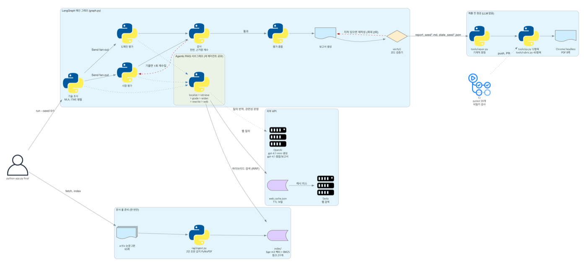
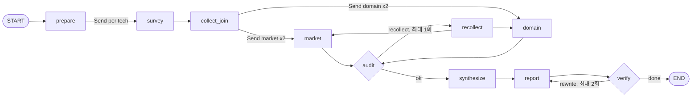
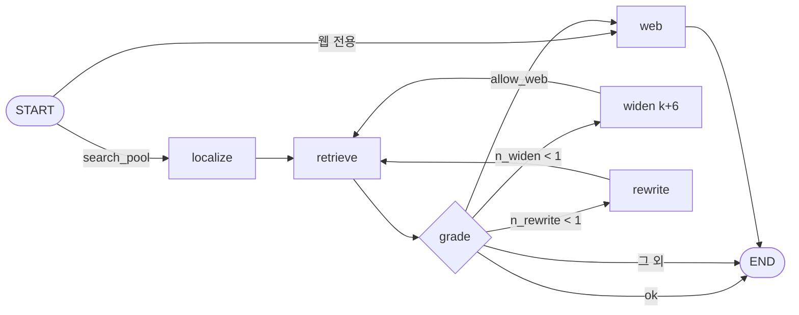

# Architecture

[Home](Home.md) | [Evaluation](Evaluation.md) | [Tradeoffs](Tradeoffs.md) | [Troubleshooting](Troubleshooting.md) | [Schedule](Schedule.md)

그림 생성 스크립트는 `docs/diagrams/architecture.py`입니다. 배포 서버는 없고 전부 로컬에서 `python app.py`로 돕니다. 외부 호출은 OpenAI(LLM)와 Tavily(웹 검색) 두 곳입니다.

## 1. 구성 요소

| 계층 | 파일 | 역할 |
|---|---|---|
| 실행 | `app.py` | `index`, `run --seed`, `compare`, `final` 명령. `final`은 색인부터 PDF, 점검까지 한 번에 |
| 설정 | `config.py` | 평가 대상 2건, 관점별 기준 5개씩, 편향 방지 장치 설명, 금지어 목록, 도메인 정의 |
| 그래프 | `graph.py` | 메인 `StateGraph` 조립, fan-out, 되돌이 상한 |
| 상태 | `state.py` | `EvalState`, `Evidence`, 병렬 갱신용 리듀서 |
| 에이전트 | `agents/nodes.py` | 기술 조사, 시장 평가, 도메인 평가, 감사, 종합, 보고서, 참고문헌, 검증기 |
| 검색 | `agents/retrieve_loop.py` | Agentic RAG 서브그래프 (localize, retrieve, grade, widen, rewrite, web) |
| 질의 | `agents/queries.py` | 대칭 질의 템플릿 (기술 조사 5, 시장 6, 도메인 5) |
| 색인 | `rag/ingest.py`, `rag/embedder.py`, `rag/retriever.py` | 2단 조판 로더, 청킹(1100자, 겹침 150), bge-m3, BM25, RRF |
| 캐시 | `rag/webcache.py` | 웹 검색 결과를 질의 키로 저장, TTL 14일, 빈 결과는 저장하지 않음 |
| 사후 처리 | `tools/repair.py`, `tools/md2pdf.py`, `tools/qa.py`, `tools/rubric.py` | 기계적 정정, PDF, 점검 12항목, 요구사항 대조 40항목 |

## 2. 메인 그래프

- `prepare`: `order_seed`가 홀수면 기술 순서를 뒤집습니다. 순서 효과를 보려고 seed 0, 1 두 번 돌립니다.
- `survey`: 기술마다 따로 `Send`. 두 기술이 서로의 결과를 보지 않습니다.
- `market`, `domain`: 기술 2개 x 관점 2개 = 4갈래 병렬. 관점끼리도 서로를 참조하지 않습니다.
- `audit`: LLM에게 묻지 않고 셉니다. 관점별 유리/불리 개수 중 하나가 0이면, 두 기술 근거 수가 2배 넘게 차이 나면, 시장성 관점 웹 근거가 0건이면 실패.
- `recollect`: 1회만. 그래도 기울면 넘어가되 그 사실을 보고서 한계 장에 적습니다.
- `verify`: 코드 검증기. 지적이 있으면 지적 목록을 붙여 보고서를 다시 쓰게 하고, 최대 2회.

LangGraph가 직접 그린 그림은 `docs/architecture.png`, `docs/retrieval_subgraph.png` (`tools/draw_graph.py`)입니다.

## 3. 검색 서브그래프

질의 템플릿(`agents/queries.py`)은 항목마다 **문서 풀용 문장**과 **웹용 문장**을 따로 갖습니다. 호출부(`agents/nodes.py _gather`)는 둘을 서로 다른 경로로 보냅니다.

| 질의 종류 | `search_pool` | `allow_web` | 경로 |
|---|---|---|---|
| 문서 풀 질의 (기술 조사, 관점 평가 모두) | True | False | localize, retrieve(`where={"doc_id": 해당 기술}`), grade, 필요하면 widen, rewrite. 그래도 없으면 `status=unknown` |
| 웹 질의 (시장, 도메인 항목 중 웹 템플릿이 있는 것) | False | True | 웹으로 바로. 결과는 캐시에 저장 |

기술 조사 템플릿에는 웹 문장이 없어서(`web=None`) 논문 사실은 웹으로 가지 않습니다. 서브그래프에는 grade에서 web으로 넘어가는 경로도 있지만, 현재 호출부는 문서 풀 질의에 웹을 허용하지 않으므로 쓰이지 않습니다. 문서 풀 검색은 해당 기술의 논문으로만 범위를 제한해, 한 기술의 근거가 다른 기술로 섞이지 않게 합니다.

## 4. State 설계

| 키 | 타입 | 리듀서 | 이유 |
|---|---|---|---|
| `techs`, `domain`, `contrast_domains`, `order_seed` | 입력 | 없음 | 실행 내내 고정 |
| `tech_briefs` | `dict[tech, TechBrief]` | `merge_by_key` | 기술별 병렬 갱신 |
| `market`, `domain_fit` | `dict[tech, PerspectiveView]` | `merge_by_key` | 관점마다 키를 나누고 그 안에서 기술별로 다시 나눔 |
| `evidence` | `list[Evidence]` | `operator.add` | 근거 원장. 모든 노드가 덧붙이기만 함 |
| `retries`, `retrieve_k` | `dict[str, int]` | `add_counts` | 루프 상한 계수 |
| `audit`, `conflicts`, `synthesis`, `report_md`, `verify` | 단일 값 | 없음 | 순차 구간 |

`Evidence`는 `id, tech, perspective, stance(pro/con/neutral), claim, cite, source_type(pool/web), url`과 출처 등급(`tier`)을 갖습니다. 평가 문장은 `cite` 꼬리표(`[MLA p.1]`, `[웹: 제목]`)로 원장을 가리킵니다.

## 5. 데이터 흐름

1. `data/fetch_papers.py`가 arXiv에서 PDF를 받습니다 (저장소에는 넣지 않음).
2. `app.py index`: 2단 조판을 감지해 열 단위로 읽고, 청크 211개를 bge-m3로 임베딩해 `index/`에 저장합니다.
3. `app.py run --seed 0`: 그래프 실행. 결과는 `outputs/state_seed0.json`, `outputs/report_seed0.md`.
4. `app.py run --seed 1`: 순서를 뒤집어 재실행. 웹 질의는 캐시에서 읽습니다.
5. `app.py compare`: 관점별 유리, 불리, 근거 없음 개수와 상충 지점 수를 나란히 비교합니다.
6. `tools/repair.py`, `tools/md2pdf.py`, `tools/qa.py`: 정정, PDF, 점검.

## 6. 실행 환경

| 항목 | 내용 |
|---|---|
| 런타임 | Python 3.11, uv |
| 외부 API | OpenAI (`gpt-4.1-mini`, `gpt-4.1`), Tavily |
| 비용과 시간 | 회당 약 95초, 0.2달러 안팎 (3차 실행 기준, 이슈 #9 기록) |
| CI | GitHub Actions: pytest, compileall, 문서 풀 200쪽, 비밀키 유출 검사. 보고서 생성은 API 키가 필요해 CI에서 돌리지 않음 |
