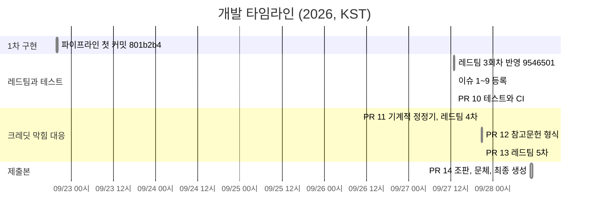

# Schedule (일정 관리)

[Home](Home.md) | [Architecture](Architecture.md) | [Evaluation](Evaluation.md) | [Tradeoffs](Tradeoffs.md) | [Troubleshooting](Troubleshooting.md)

git log, 이슈, PR의 시각(KST)으로 만든 실제 타임라인입니다.

## 타임라인

| 시각 (KST) | 이벤트 | 내용 |
|---|---|---|
| 09-22 19:46 | 커밋 `801b2b4` | 그래프, 검색 서브그래프, 하이브리드 검색기, 검증기, 실측 스크립트, 보고서 변환까지 32파일 9,867줄 |
| 09-27 12:48 | 커밋 `9546501` | 레드팀 3회차 반영: 꼬리표 내용 대조, 출처 등급, URL 생존 확인, 최종 점검 도구 (11파일, +1,205 -718) |
| 09-27 12:51 | 커밋 `298ca0d` | arXiv 서지 대조를 초록 페이지 방식으로 교체 |
| 09-27 12:57 | 이슈 #1 ~ #9 등록 | 그때까지의 작업 단위(파싱, 임베딩, 검색 루프, 편향 장치, 레드팀 1~3차, CI, 최종 제출)를 이슈로 정리. #1~#8은 13:04에 해결 내용을 적고 닫음 |
| 09-27 12:58 ~ 13:03 | PR #10 | 검증기 회귀 테스트, 그래프 구조 테스트, CI (39개 통과) |
| 09-27 13:04 | 이슈 #9 댓글 | OpenAI 403으로 재생성이 막힌 상황과 시도한 경로 기록 |
| 09-27 20:38 | 이슈 #9 댓글 | 정정기로 만든 중간 산출물 확정 (지적 0건, 점검 주의 1) |
| 09-27 20:35 ~ 20:38 | PR #11 | LLM 없는 정정기, 레드팀 4차 (42개 통과, 점검 주의 1) |
| 09-27 20:46 ~ 20:47 | PR #12 | 웹 참고문헌 형식 (44개 통과) |
| 09-27 20:54 ~ 20:58 | PR #13 | 레드팀 5차: 단위까지 대조, 선정 사유 고정 (46개 통과) |
| 09-27 20:59, 21:01 | 커밋 `2b09751`, `5520911` | 구조도 검사 수정, 레드팀 8차 (선정 사유와 본문 충돌 제거) |
| 09-28 10:29 ~ 11:13 | PR #14 | 크레딧 복구 후 정방향, 역방향 재생성, 조판과 문체, 검증기 정확도. 점검 12/12, 대조 40/40, 테스트 57개 |
| 09-28 11:13 | 이슈 #9 종료 | 최종 PDF 확정, 순서 효과 검증 완료 |

## 일을 나눈 방식

**이슈는 문제 단위로.** 각 이슈는 `문제 → 측정 → 결정 → 확인` 순서로 쓰고, 닫을 때 해결 위치(파일, 함수)와 수치를 한 줄로 남겼습니다. 라벨은 `rag-pipeline`(#1~#3), `evaluation`(#4), `red-team`(#5~#7), `infra`(#8), `blocked`(#9)입니다.

**레드팀 결과는 회귀 테스트로.** 레드팀 한 번이 끝나면 찾은 실패를 이슈로 남기고, 고친 뒤 그 사례를 `tests/test_verify.py`에 고정했습니다. 테스트 수가 PR마다 39, 42, 44, 46, 57로 늘어난 것이 그 흔적입니다 (현재 59개).

**막힌 일은 막힌 대로 기록.** OpenAI 접근이 막혔을 때 이슈 #9에 시도한 경로와 결과를 표로 남기고, 막히지 않은 부분(정정기, 참고문헌 형식, 레드팀 5차)을 PR #11~#13으로 먼저 진행했습니다.

## 브랜치 전략

| 접두어 | 용도 | 예 |
|---|---|---|
| `feat/` | 새 기능 | `feat/tests-and-ci` |
| `fix/` | 레드팀 반영, 결함 수정 | `fix/deterministic-report-repair`, `fix/reference-format`, `fix/redteam-5` |
| `polish/` | 제출본 정리 | `polish/typography-and-voice` |

PR은 모두 본인이 만들고 본인이 머지했습니다. 본문에는 `Closes #n` 또는 `Refs #n`으로 이슈를 연결하고, 확인 단계에 테스트 수와 `tools/qa.py` 결과를 붙였습니다. 첫 구현과 일부 소규모 수정(`9546501`, `298ca0d`, `2b09751`, `5520911`)은 main에 직접 커밋했습니다.

## 돌아보면

첫 커밋이 9,867줄 한 덩어리라서 초기 설계 과정이 git 기록에 남지 않았습니다. 이슈 #1~#9도 작업이 끝난 뒤 정리한 것이라 등록과 종료 시각이 몇 분 차이입니다. 다음에는 레드팀 회차마다 이슈를 먼저 열고 PR로 닫는 순서로 진행할 생각입니다.
